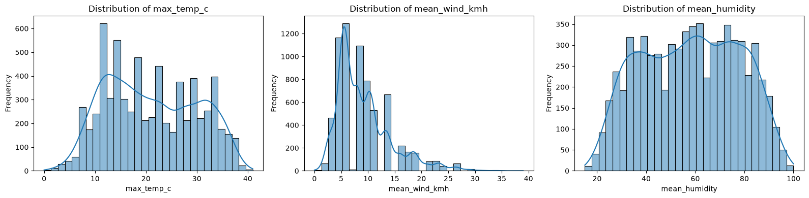
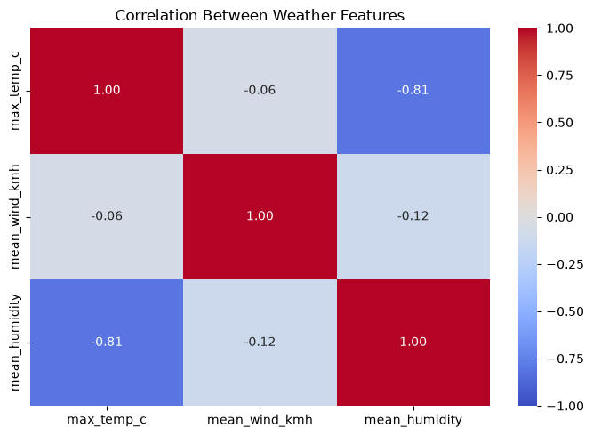
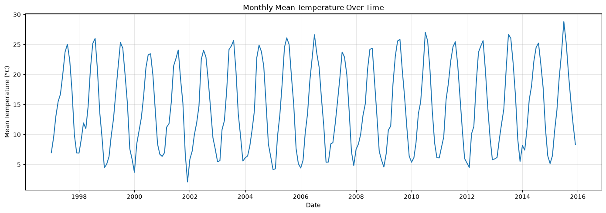
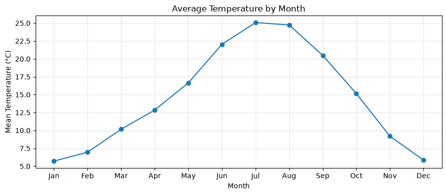
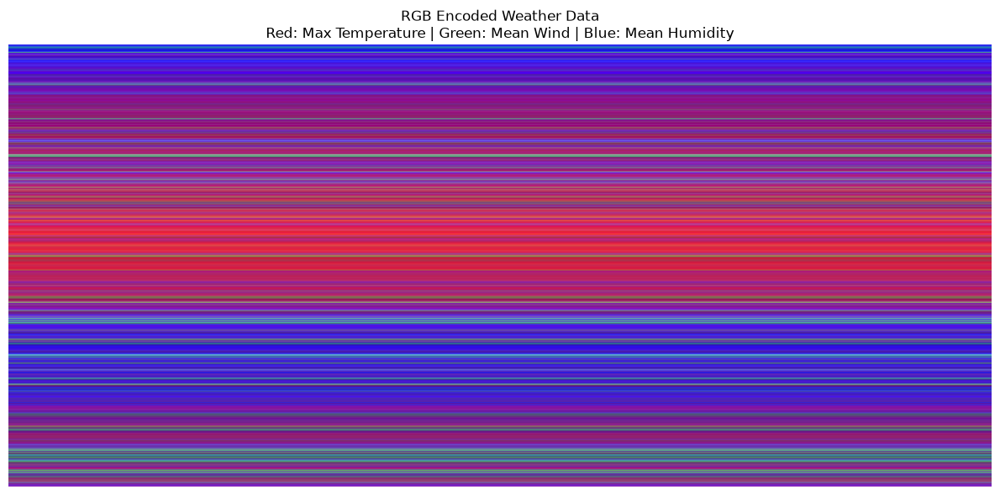
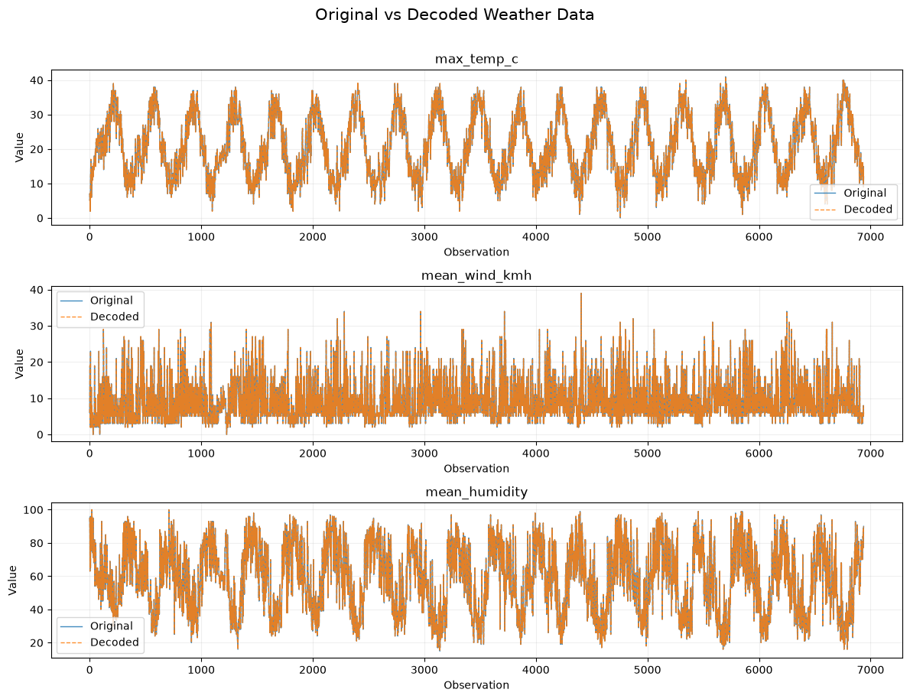
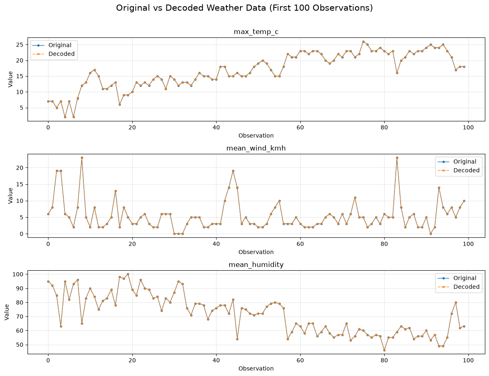
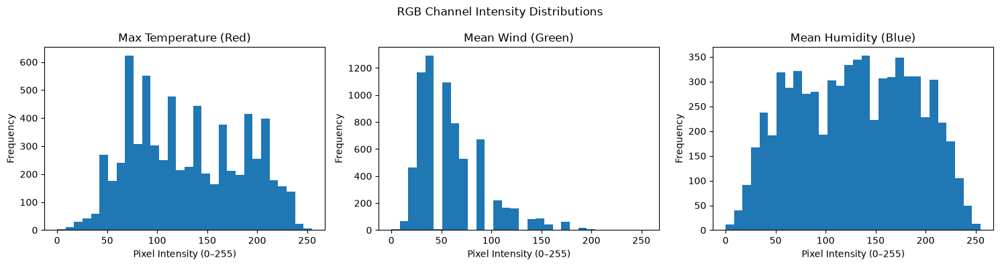
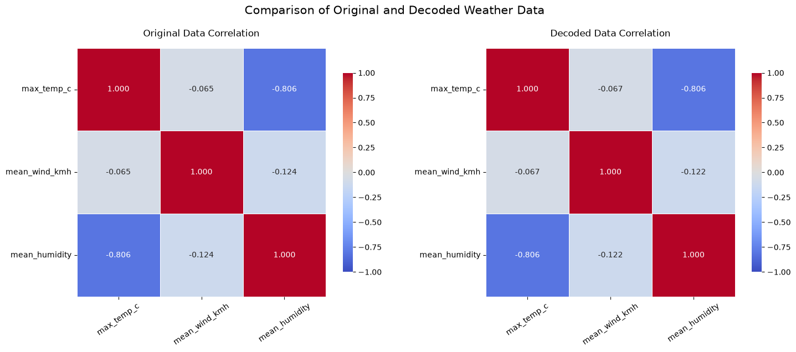

# Madrid Daily Weather (1997–2015): Data Analysis and Computer Vision

This notebook uses the **Madrid Daily Weather (1997–2015)** dataset. The conclusions below are based on the outputs and visualizations saved in the submitted notebook.

## 2. Dataset overview
- **Original dataset:** 6,812 rows and 23 columns.
- **Expected daily date range after reindexing:** 1 January 1997 to 31 December 2015.
- **Continuous daily records after adding missing dates:** 6,939 rows.
- **Features selected for image encoding:** maximum temperature (`max_temp_c`), mean wind speed (`mean_wind_kmh`), and mean humidity (`mean_humidity`).

## 3. Data cleaning conclusions
Identified inconsistent column names and a date field stored as text. Column names were standardized and the date column was converted to a datetime index. Reindexing the daily series revealed **127 missing dates**, which were added to create a continuous timeline.

The cleaning process then:
- dropped `max_gust_kmh` because approximately half of its values were missing;
- replaced missing event labels with `No event`;
- changed one invalid wind-direction value (`-1`) to a missing value;
- interpolated numeric values over time, with a limit of seven days, and used day-of-year medians to fill remaining numeric gaps;
- checked temperature ordering, humidity range, and wind-direction range;
- flagged outliers rather than automatically deleting potentially real extreme-weather observations.

The final validation reports **6,939 rows × 22 columns**, **zero missing values**, and **zero duplicated dates**. The cleaning therefore produced a complete, regularly indexed daily dataset for the subsequent analysis.

## 4. Exploratory data analysis (before encoding)

### Feature distributions
The distributions show the spread and frequency of values for maximum temperature, mean wind speed, and mean humidity. These plots provide a baseline for interpreting the same variables after encoding and decoding.

### Correlations in the original data
The original correlation matrix reports:
- maximum temperature vs. mean humidity: **−0.8061**, a strong negative relationship;
- maximum temperature vs. mean wind speed: **−0.0646**, a very weak negative relationship;
- mean wind speed vs. mean humidity: **−0.1242**, a weak negative relationship.

The strongest relationship among these three variables is the negative association between maximum temperature and mean humidity.

### Temperature over time
The monthly mean-temperature visualization provides a time-series view across the study period. It complements the distributions by showing how temperature varies over time rather than only how often values occur.

## 5. Encoding the dataset as an image
Three numeric features were selected and scaled for RGB image encoding:
- **Red channel:** maximum temperature;
- **Green channel:** mean wind speed;
- **Blue channel:** mean humidity.

The encoded array's original dimensions were **(6,939, 1, 3)**. For display and image-processing, it was expanded horizontally to **(6,939, 600, 3)**. The notebook verified that every pixel in a row was repeated horizontally. Thus, the width expansion changes the visualization size but does not add new independent measurements.

## 6. Computer-vision examination and decoding
We uses OpenCV to work with the encoded RGB image, extracts the RGB channels, and reconstructs the selected feature values from the image. It also checks horizontal pixel repetition. The check returned **True**, confirming that the display image repeats each row horizontally as intended.

The decoded sample values are close to the original measurements, but the conversion from scaled numeric values to image channel values introduces small reconstruction differences.

### RGB channel inspection
The channel visualization makes it possible to inspect each encoded variable separately. Because each channel stores a different feature, channel-level inspection provides a visual representation of how the three weather variables change across the daily sequence.

## 7. Quantitative comparison: original data vs. decoded image
We reports the following reconstruction errors:

| Feature | MAE | RMSE |
|---|---:|---:|
| Maximum temperature (`max_temp_c`) | 0.039849 | 0.046161 |
| Mean wind speed (`mean_wind_kmh`) | 0.041982 | 0.045591 |
| Mean humidity (`mean_humidity`) | 0.001395 | 0.014015 |
| **Overall** | **0.027742** | **0.038322** |

MAE (Mean Absolute Error) measures the average absolute difference between original and decoded values. RMSE (Root Mean Squared Error) penalizes larger differences more strongly. The reported errors are small, indicating that the image encoding and decoding process preserved the selected measurements closely. Humidity has the smallest reconstruction error in the notebook; wind speed has the largest feature-wise MAE of the three.

**Important interpretation:** these metrics measure how closely values were reconstructed from the encoded image. They do not measure weather-prediction accuracy or the performance of a trained object-detection/classification model.

## 8. Comparison of correlations before and after encoding
Comparing the original correlations with correlations calculated from the decoded values.

| Feature pair | Original correlation | Decoded correlation |
|---|---:|---:|
| Maximum temperature – mean wind speed | −0.0646 | −0.067 |
| Maximum temperature – mean humidity | −0.8061 | −0.806 |
| Mean wind speed – mean humidity | −0.1242 | −0.122 |

The correlations remain very similar after decoding. In particular, the strong negative relationship between maximum temperature and humidity is preserved. This supports the conclusion that the encoding/decoding process retained the main correlation structure of the selected data.

## 9. Overall conclusions
1. **Cleaning improved consistency:** the daily timeline was completed and the notebook's final checks report no missing values or duplicate dates.
2. **EDA revealed a clear relationship:** maximum temperature and mean humidity have a strong negative correlation (−0.8061), while the two other feature pairs have weak negative correlations.
3. **The image represents the selected data:** the three variables were mapped to RGB channels and the displayed rows were verified to repeat horizontally.
4. **Reconstruction was close to the original:** the overall MAE was 0.027742 and overall RMSE was 0.038322.
5. **The main statistical pattern was preserved:** correlations calculated after decoding were very close to the original correlations.
6. **The two approaches are complementary:** conventional data analysis provides interpretable statistics and trends, while the image representation allows the variables to be inspected through image channels and computer-vision operations. In this notebook, the comparison indicates that image encoding preserved the selected numerical information with small errors.

